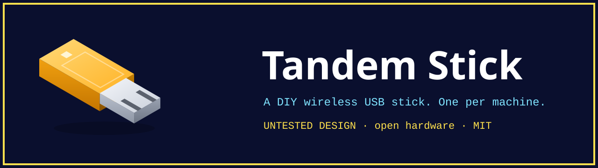

<a href="https://mkalmousli.github.io/tandem-stick/"><b>See how it works →</b></a> ·
<a href="https://mkalmousli.github.io/tandem-stick/#/explore">Explore in 3D</a> ·
<a href="https://mkalmousli.github.io/tandem-stick/#/downloads">Downloads</a>

   

Open hardware DIY project: a button-free USB stick that pairs with other sticks by radio, so one host controls many machines. One stick per target, one for you.

**Status: untested DIY design.** The board passes design-rule checks and the case is printable, but nothing has been built or tested on hardware. Firmware is coming later.

**Site:** https://mkalmousli.github.io/tandem-stick/

Three pages and a GitHub link:

| Page | What it has |
|---|---|
| Home | Scroll presentation: how it works, a live 3D demo with five real-life scenarios, use cases, host vs target, FAQ |
| Explore | The main thing. 3D viewer with tabs for Tour, Parts, Signal, Guide (drawings, pinout, build, print, plan) and Files (every file previewed: board from the Gerbers, case STL in 3D, BOM and placement tables, source) |
| Downloads | Bundles and files with SHA-256 checksums you can verify in the browser |

## Repository

    web/          static site: one index.html, all UI in plain scripts under web/js (three.js r160 vendored)
    hardware/     KiCad board generated by build_board.py, DRC script, fab outputs
    mechanical/   printable case STLs and their generator
    scripts/      build-site.mjs assembles dist/ with bundles and checksums
    tests/        node:test suite for the design data, board files and site scripts

## Develop

    npm test           # design checks
    npm run serve      # build dist/ and open http://localhost:8765

Needs Node 20+ and the `zip` command. Serve the site over HTTP rather than opening it from `file://`.

## Caveats

- Part numbers are candidate families; verify datasheets and stock before ordering.
- Costs are rough estimates, not quotes.
- No ESD diode, no schematic or ERC yet; see Explore → Guide → Roadmap and risks.

Licence: MIT. Three.js is MIT, see `web/explorer/vendor/LICENSE-three`.
