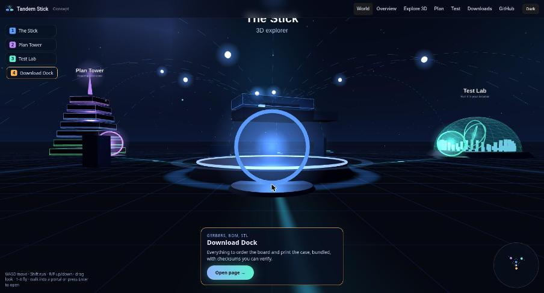
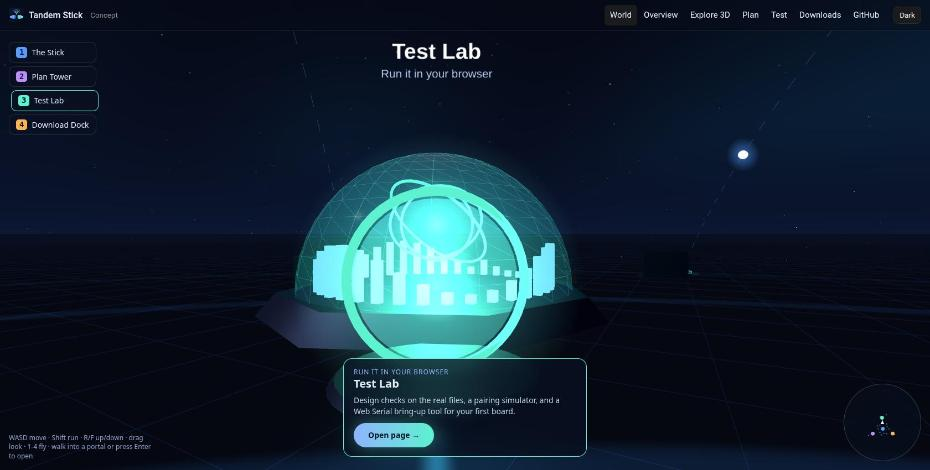

<a href="https://mkalmousli.github.io/tandem-stick/"><b>Walk the 3D world →</b></a> ·
<a href="https://mkalmousli.github.io/tandem-stick/explore.html">Explorer</a> ·
<a href="https://mkalmousli.github.io/tandem-stick/plan.html">Plan</a> ·
<a href="https://mkalmousli.github.io/tandem-stick/downloads.html">Downloads</a>

   

Open hardware concept: a button-free USB stick that pairs with other sticks by radio, so one host controls many machines. One stick per target, one for you.

**Status: concept.** Board design is DRC-clean and the case is printable, but no board has been built or tested on hardware.

| | |
|---|---|
|  |  |

The landing page is an open-world scene: fly or walk (WASD, drag, touch pad) between the stick, the plan tower, the test lab and the download dock, watch the fleet talk by radio, and walk into a portal to open that page.

**Site:** https://mkalmousli.github.io/tandem-stick/

| Page | What it has |
|---|---|
| [World](web/index.html) | Open-world 3D landing: walkable, live radio traffic, portals to every page |
| [Explore 3D](web/explore.html) | Guided tour, exploded view, clickable parts, signal paths, shareable links, keyboard shortcuts |
| [Plan](web/plan.html) | Requirements, architecture, firmware, security, roadmap with gates, costs, compliance, risks |
| [Test lab](web/test.html) | Automated design checks, pairing/latency simulator, Web Serial bring-up tool, first-article checklist |
| [Downloads](web/downloads.html) | Gerbers, BOM, placement, KiCad project, case STL, SHA-256 checksums |

## Repository

    web/          static site (no build step for pages); web/explorer is the three.js viewer (r160 vendored)
    hardware/     KiCad board generated by build_board.py, DRC script, fab outputs
    mechanical/   printable case STLs and their generator
    scripts/      build-site.mjs assembles dist/ with bundles and checksums
    tests/        node:test suite shared with the in-browser Test lab

## Develop

    npm test           # design checks
    npm run serve      # build dist/ and open http://localhost:8765

Needs Node 20+ and the `zip` command. The pages use ES modules, so they must be served over HTTP, not opened from `file://`.

## Caveats

- Part numbers are candidate families; verify datasheets and stock before ordering.
- Costs are ±30% estimates, not quotes.
- No ESD diode, no schematic or ERC yet; see the [plan](web/plan.html#risks).
- Selling radio hardware in the EU needs CE/RED/EMC compliance.

Licence: MIT. Three.js is MIT, see `web/explorer/vendor/LICENSE-three`.
